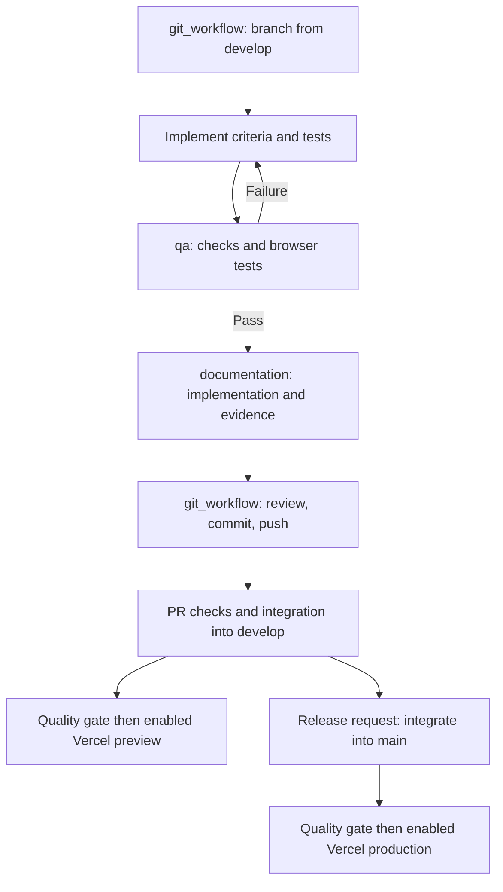

# Coffee shop delivery pipeline

## Stack and branches

Use Next.js App Router, strict TypeScript, Tailwind CSS, Supabase PostgreSQL, GitHub/GitHub Actions, and Vercel. Use npm and commit `package-lock.json`. Node 22 is the CI/deployment baseline. Repository: https://github.com/francisfifth-dotcom/repo-test.git.

`develop` is the integration branch; `feature/<slug>` starts from its current remote state. `main` is production and receives `develop` only on an explicit release request.



## Session agent lifecycle

The primary agent coordinates these agents for every completed feature:

1. `git_workflow` inspects status, preserves unrelated work, fetches origin, fast-forwards `develop`, and creates `feature/<slug>` before implementation. For first setup it can create `develop` from `origin/main`. Only this agent owns Git mutations; coordinate branch switches with all writers sharing the worktree.
2. The primary/implementation agent defines acceptance criteria and implements one feature with appropriate tests.
3. `qa` runs `npm run check` and browser tests against the production build. Check desktop/mobile, relevant loading/error/empty states, keyboard access, and console failures. Database-dependent behavior requires isolated integration validation. Return failures to implementation and repeat QA; unavailable checks never become PASS.
4. `documentation` writes the final `docs/features/<slug>.md` after QA, using `docs/templates/feature.md`. Record actual behavior, evidence, migrations, environment names, limitations, deployment, and rollback. Update README, pipeline, and changelog guidance as needed.
5. `git_workflow` reviews the diff, stages explicit feature-owned paths, commits and pushes, and opens a PR to `develop` when tooling is available. Wait for required remote checks before merging. Its instructions permit local `--no-ff` integration if PR tooling is unavailable, only after local QA/documentation, another QA run on the merge result, and a normal push. Respect protection; never force push or bypass it. Report unobserved remote CI accurately. If newer `develop` changes the tested integration, return to QA and documentation.

Definitions are `.codex/agents/git_workflow.toml`, `.codex/agents/qa.toml`, and `.codex/agents/documentation.toml`; `.codex/config.toml` enables project agents. Discovery may require restarting the session. Clients without custom-agent support must spawn agents using the corresponding TOML instructions explicitly. These run within Codex sessions, not automatically outside them. GitHub Actions runs deterministic checks, not AI agents.

## Commands and GitHub Actions

```sh
npm ci
npm run dev
npm run check
npx playwright install chromium
npm run test:e2e
```

`check` runs ESLint, `tsc --noEmit`, Vitest, and `next build --webpack`. Browser tests require that build and start a production server on `127.0.0.1:3107`; reserve the port. The fallback test intercepts PostgREST menu requests with a deterministic HTTP 400 before navigation; no real database access is required for that regression check. Next.js embeds public variables at build time, so the runtime blank values in the test server configuration do not remove values already compiled into the build. These tests cover desktop Chromium and Pixel 7 emulation, not live database correctness.

`.github/workflows/pipeline.yml` runs on pushes to `main`, `develop`, `feature/**`, and `fix/**`, PRs targeting `develop`/`main`, and manual dispatch. `Quality gate` uses Node 22, installs from the lockfile, runs `check`, installs Chromium with system dependencies, and runs browser tests. Failure artifacts are retained for seven days.

`Documentation gate` runs on PRs. `scripts/check-docs.mjs` requires an added/updated `docs/features/*.md` report when covered implementation/configuration paths change. A deleted report cannot satisfy it; README-only changes do not require a report. This verifies file presence, not report accuracy or QA order; agent/reviewer verification remains required.

Configure GitHub repository rules for `develop` and `main` requiring PRs and `Quality gate`/`Documentation gate` checks. Confirm exact check names after the first run. Do not bypass protections. Repository admin permissions and plan capabilities may affect available settings. Remote branch rules remain unverified. The production source commit’s GitHub Actions `Quality gate` was observed successful; deployment was skipped because enablement is off, and the documentation gate is skipped on push events.

## Supabase setup

Current project: the existing migration and seed were manually applied successfully through the Supabase SQL editor. The corrected `.supabase.co` Project URL and matching key now return three menu rows, and actual Preview desktop/mobile live reads passed. RLS/grant metadata was inspected; isolated database and full negative API tests remain pending. See [connection evidence](features/supabase-vercel-connection.md). Do not rerun the existing nonrepeatable CREATE migration against this project; reconcile its applied baseline before adopting CLI migration tracking.

1. Create an isolated staging Supabase project first, and preferably a separate production project for real data. Copy `.env.example` to `.env.local`; configure `NEXT_PUBLIC_SUPABASE_URL` and `NEXT_PUBLIC_SUPABASE_PUBLISHABLE_KEY` from the same project’s Data API settings. Hosted project URLs use `.supabase.co`; copy the exact URL rather than using `.supabase.com`.
2. Review/apply `supabase/migrations/20261018000100_menu.sql` through the SQL editor or controlled migration tooling. It creates `public.menu_items`, requires nonnegative integer `price_cents`, enables RLS, revokes existing anonymous/authenticated access, grants SELECT only, and limits SELECT to available rows.
3. Optionally run `supabase/seed.sql` separately after the migration. It inserts three fixed-ID demo drinks and ignores ID conflicts. The migration itself is not repeatable; track application through your migration process.
4. Verify available rows can be read, unavailable rows remain hidden, and anonymous/authenticated writes fail. Verify successful “Load live menu” behavior before declaring live data ready.

Never expose database passwords, secret keys, or service-role keys in browser variables or commits. Public clients have no order/admin write grants. Future transactions must use authoritative server prices and a confirmed business currency. No automatic migration job is included: apply reviewed migrations before dependent releases. The original scaffold QA did not run database integration. The subsequent connection work applied the SQL and verified live reads and security metadata; it did not run isolated migration tests or full negative API permission tests.

## Vercel setup and rollout

The existing Vercel project `repo-test` in `francis-s-projects1` is connected to this GitHub repository with production branch `main`. The project framework is Next.js and Node version is now `22.x`; `package.json` and its lockfile also pin `22.x`. The local CLI link is in ignored `.vercel/`.

The public [production app](https://repo-test-wine.vercel.app) was manually deployed from `main` commit `e89735bfa14bc58339a2f7d70beb27b7be679b24` after local QA and an observed successful GitHub Actions quality check. Actual desktop/mobile live Supabase reads passed without cookies or authentication headers. See [the production release report](features/production-release.md). Preview/unique deployment URLs may remain protected; SSO settings were not changed. Automatic workflow deployment remains disabled.

1. Use the existing project. `NEXT_PUBLIC_SUPABASE_URL` was corrected in ignored `.env.local` and Vercel Preview/Production; the matching publishable key was preserved. The URL is now a Vercel Config value because the CLI rejects creating `NEXT_PUBLIC_` names as Secret; the existing key remains Secret. For future changes, copy the exact URL/key from the active project’s Settings → Data API, update the intended environments, then rebuild/redeploy and repeat live QA. Prefer separate staging/production databases. Public variables are embedded at build time; runtime changes alone do not repair an existing build.
2. Configure GitHub repository/environment secrets `VERCEL_TOKEN`, `VERCEL_ORG_ID`, and `VERCEL_PROJECT_ID`. The workflow uses GitHub `preview` and `production` environments, allowing environment-specific credentials. Configure production environment approval rules if desired.
3. Leave repository variable `VERCEL_DEPLOY_ENABLED` unset until credentials, environment variables, database permissions, and project settings are ready. Set it to literal `true` to enable deployment.
4. Integrate tested features into `develop`. After that push's quality job succeeds, deployment uses the lockfile-installed Vercel CLI to submit a remote source build with `vercel deploy --yes --target=preview`. Vercel builds with the project’s Preview environment values. Verify the URL in the workflow summary and exercise live reads.
5. On an explicit release request, integrate tested `develop` into `main`. After quality succeeds, the workflow submits a remote source build using `vercel deploy --yes --prod`, with Production environment values. Verify the public URL and live reads.

The existing publishable key remains stored as Secret in Vercel. In the earlier observed CLI pull, Secret values became `[SENSITIVE]` placeholders rather than usable local build values. The workflow therefore uses hosted source builds, avoiding a prebuilt client bundle with those placeholders. Manual Preview and Production deployments verified this method. GitHub Actions quality execution was observed, but its deployment job was skipped; automatic deployment credentials remain unverified.

`vercel.json` disables native Git deployments to avoid duplicate ungated deployments. Feature branches and PRs run checks but do not deploy. Manual dispatch runs quality but does not deploy: deployment requires a push event. Deployment depends on quality; the documentation check is enforced through protected PRs. A local build does not prove deployment.

For an explicitly requested manual Preview deployment after local QA, use the existing CLI login and project link:

```sh
npx --no-install vercel link --yes --project repo-test --scope francis-s-projects1
npm run check
npm run test:e2e
npx --no-install vercel deploy --yes --scope francis-s-projects1
```

Omitting `--prod` keeps this a Preview deployment. Verify READY status, authenticated HTTP/browser access, and the live menu separately. The CLI may add an OIDC token to ignored `.env.local`; keep that file, `.vercel/`, protection-bypass tokens, session cookies, and verification artifacts out of Git. Preview verification used authorized automated protection access without disabling SSO.

For an explicitly requested manual Production release, have `git_workflow` select a clean, current `main` after integration and confirm its source SHA. Run local QA and observe the source commit’s required remote quality checks before deploying:

```sh
npm run check
npm run test:e2e
npx --no-install vercel deploy --yes --prod --scope francis-s-projects1
```

Confirm the new deployment is READY and check the public production alias and live reads without an authenticated session. Redeploying an old failed deployment retains its old source; choose current `main` and create a new deployment instead. The prior `NEXT_NO_VERSION` failure came from initial commit `72d1007`, which predated the Next.js app; current main already contained Next.js 16.4.2, so no dependency or root-directory fix was needed.

For rollback, disable `VERCEL_DEPLOY_ENABLED` if necessary to stop further deployments and restore a known-good prior deployment through Vercel controls. Revert application changes through a reviewed feature/PR and QA. Prefer reviewed forward database fixes; assess compatibility and backups before database changes. Public Production and protected Preview reads are verified; automatic deployment credentials/enablement, remote branch protection, isolated database/negative-permission validation, and rollback execution remain unverified.

## References

- [Codex subagent configuration](https://learn.chatgpt.com/docs/agent-configuration/subagents)
- [Tailwind CSS with Next.js](https://tailwindcss.com/docs/installation/framework-guides/nextjs)
- [Supabase Next.js quickstart](https://supabase.com/docs/guides/getting-started/quickstarts/nextjs)
- [Vercel CLI](https://vercel.com/docs/cli) and [Git deployment configuration](https://vercel.com/docs/project-configuration/git-configuration)
